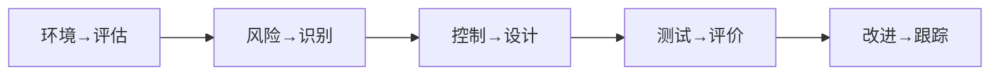

# 内部控制评价系统 — 工作流技能

## 一、模块设计

| 模块 | 职责 | 输入 | 输出 |
|------|------|------|------|
| **1. 环境评估** | 了解企业内部控制环境、组织架构与权责分配 | 制度/流程文档 | 控制环境评价 |
| **2. 风险识别** | 识别业务流程中的风险点，构建风险矩阵（可能性×影响） | 流程+控制目标 | 风险矩阵 |
| **3. 控制设计** | 设计/匹配控制活动：授权审批、职责分离、系统控制、资产保护 | 风险矩阵 | 控制措施库 |
| **4. 测试评价** | 执行控制测试，评估设计有效性与运行有效性 | 控制措施+抽样 | 缺陷评价 |
| **5. 改进跟踪** | 针对缺陷提出整改方案并跟踪落实 | 缺陷评价 | 整改闭环 |

## 二、工作流程

**步骤 1 · 环境评估**

针对「内部控制评价系统」，评价企业内部控制环境：治理结构、管理层理念、组织架构、人力资源政策。了解风险偏好与风险承受度，确定控制环境的总体基调。

**步骤 2 · 风险识别**

梳理关键业务流程节点，识别操作风险、财务风险、合规风险与信息风险。构建风险矩阵：每个风险点标注发生可能性（1-5）和影响程度（1-5），计算风险价值。

**步骤 3 · 控制设计**

针对高/中风险点设计控制措施：预防性（审批、职责分离）、检查性（对账、盘点）、纠正性（差异处理、退赔）。确保不相容职务分离与关键控制点的全覆盖。

**步骤 4 · 测试评价**

抽取控制运行样本（如50笔付款审批、30笔采购订单），逐项测试控制的有效性。发现控制偏差时，评估为一般/重要/重大缺陷，记录测试底稿。

**步骤 5 · 改进跟踪**

针对识别的内部控制缺陷，制定整改方案（责任人、时限、措施）。建立整改台账并定期跟踪完成率，形成闭环管理。
